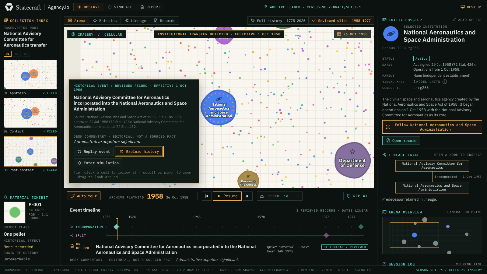
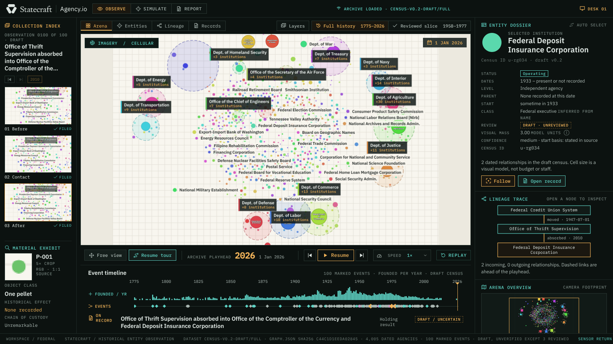
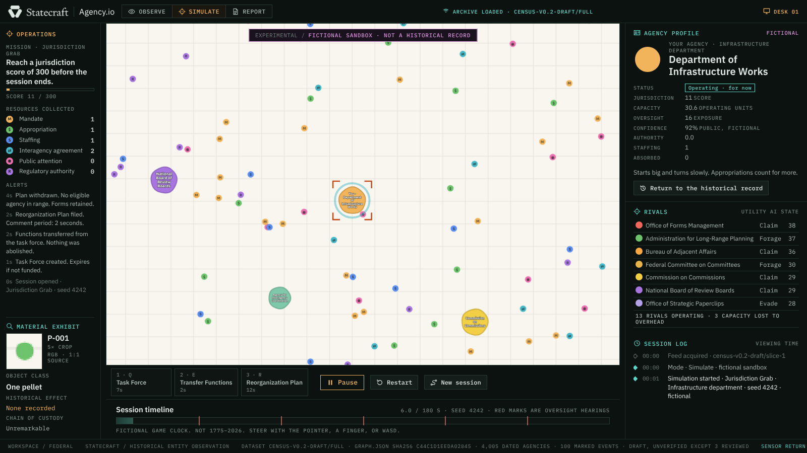

# Agency.io

**▶ Play it: [agency-io-cyan.vercel.app](https://agency-io-cyan.vercel.app)**

Two hundred and fifty years of U.S. federal agencies, shown as cells that are born, split, merge and get absorbed, all watched from an extremely serious observation desk.

The cells are silly. The archive tries hard not to be: every historical claim links to a source, and draft data is labelled as draft.

## What you can do

- **Observe**: watch real history from 1775 to 2026. The site opens on a reviewed event (NACA joining NASA in 1958). After that you can play the full archive at speeds from −1× (yes, backwards) to 25×, click any agency to follow it, open its record, and trace its lineage.
- **Simulate**: a clearly fictional game. Pick an agency type, steer it around, collect mandates and appropriations, deploy a Task Force, file a Reorganization Plan, and survive oversight hearings against rivals like the Office of Strategic Paperclips.
- **Report**: turn a historical event or your last game into a briefing card (16:9 or 9:16 PNG) to share.

## Links that open a specific view

| Link | Opens |
|---|---|
| [`?story=naca-nasa`](https://agency-io-cyan.vercel.app/?story=naca-nasa) | NACA → NASA, 1958 |
| [`?story=aec-split`](https://agency-io-cyan.vercel.app/?story=aec-split) | The Atomic Energy Commission splits in two, 1975 |
| [`?date=1958-10-02&entity=u-rg255`](https://agency-io-cyan.vercel.app/?date=1958-10-02&entity=u-rg255) | Full history on that date, following NASA |
| [`?mode=simulate&scenario=jurisdiction-grab&seed=12345`](https://agency-io-cyan.vercel.app/?mode=simulate&scenario=jurisdiction-grab&seed=12345) | A game with a fixed seed |
| [`?mode=report&story=naca-nasa&format=vertical`](https://agency-io-cyan.vercel.app/?mode=report&story=naca-nasa&format=vertical) | A vertical briefing card |

Add `?intro=0` to skip the opening.

## How much of this is true?

- **Reviewed (3 events):** NACA → NASA (1958), the Atomic Energy Commission split (1975), and ERDA → Department of Energy (1977, shown as a partial view). Their dates and sources were checked by hand.
- **Draft (everything else):** about 4,000 agencies and 579 relationships from the Statecraft census v0.2 draft, built from the National Archives' Guide to Federal Records and the U.S. Government Manual. It hasn't been reviewed by a person. Some start years only mark when the archive's records begin; the app says so instead of calling them founding dates.
- **Cell size** is a visual model. It isn't budget, staff or legal power.
- **Simulate** is fiction. Its agencies, scores and outcomes are invented.

Full counts and known gaps: [`docs/data-caveats.md`](docs/data-caveats.md).

## Run it locally

It's a single static page with no build step, backend or API keys. Open `index.html` in a browser.

## For contributors

- Sources are in `tools/` and get assembled into `index.html` by `sh tools/build.sh`. Copy `tools/index.html` to the repo root afterwards.
- Data checks: `python3 -I tools/validate_census.py tools/hist.js docs`.
- Tests (Playwright): `node tests/acceptance.test.js` and `node tests/blueprint.test.js`.
- See [`HANDOFF.md`](HANDOFF.md) and [`docs/decisions.md`](docs/decisions.md).

Original work by Statecraft. The cell-growth idea is inspired by the genre; this is not affiliated with Agar.io or with any government agency.
